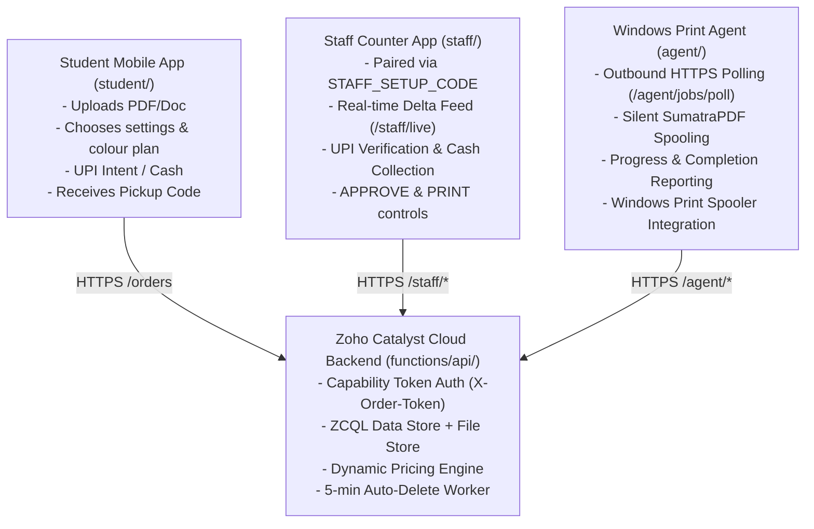

# PrintBK Production Runbook & Operator Guide

> **Target Environment**: Zoho Catalyst Serverless (Node 18), Windows 10/11 Counter & Print PCs, React 19 Frontend Web Apps (Student & Staff Counter).

---

## 1. System Architecture Overview

PrintBK operates as a zero-mock, real-time distributed printing system:



---

## 2. Windows Print Agent Installation on Shop PC

The print agent runs as a native background service on the shop PC connected to the B&W and Colour printers. It requires no inbound ports or open firewall pinholes (100% outbound HTTPS).

### Prerequisites on Shop PC
1. **Node.js 18+ LTS**: Installed and added to system PATH.
2. **SumatraPDF**: Installed to `C:\Program Files\SumatraPDF\SumatraPDF.exe` (or in system PATH). SumatraPDF is used for silent, direct command-line PDF printing (`-print-to "<PrinterName>" -silent`).
3. **Printers Installed**: Ensure the B&W printer (e.g. `EPSON L3110 Series`) and Colour printer are installed in Windows Settings and can print a Windows test page.

### Installation via NSSM (Non-Sucking Service Manager) — Recommended

NSSM provides robust automatic restart on crash, graceful shutdown, and Windows service lifecycle management.

1. Download NSSM from [nssm.cc](https://nssm.cc/download) and place `nssm.exe` in `C:\tools\nssm\`.
2. Open PowerShell as **Administrator** and run:

```powershell
# Set installation directory
$AgentDir = "C:\PrintBK\agent"
cd $AgentDir

# Install dependencies and build TypeScript code
pnpm install
pnpm run build

# Configure Environment Variables
# In Windows System Environment or .env in C:\PrintBK\agent\.env:
# BACKEND_URL=https://printbk-app.catalystserverless.in/server/api
# AGENT_TOKEN=your-production-agent-token
# SUMATRA_PATH=C:\Program Files\SumatraPDF\SumatraPDF.exe
# POLL_INTERVAL_MS=2000

# Install Windows Service via NSSM
C:\tools\nssm\nssm.exe install PrintBKAgent "C:\Program Files\nodejs\node.exe" "C:\PrintBK\agent\dist\index.js"
C:\tools\nssm\nssm.exe set PrintBKAgent AppDirectory "$AgentDir"
C:\tools\nssm\nssm.exe set PrintBKAgent AppStdout "$AgentDir\logs\agent.log"
C:\tools\nssm\nssm.exe set PrintBKAgent AppStderr "$AgentDir\logs\error.log"
C:\tools\nssm\nssm.exe set PrintBKAgent AppRestartDelay 5000
C:\tools\nssm\nssm.exe set PrintBKAgent Start SERVICE_AUTO_START

# Start the service
Start-Service PrintBKAgent
Get-Service PrintBKAgent
```

### Alternative: Native PowerShell Scheduled Task / Service
If NSSM is not permitted, create a persistent Scheduled Task that starts on system boot:

```powershell
$Action = New-ScheduledTaskAction -Execute "node.exe" -Argument "dist/index.js" -WorkingDirectory "C:\PrintBK\agent"
$Trigger = New-ScheduledTaskTrigger -AtStartup
$Principal = New-ScheduledTaskPrincipal -UserId "SYSTEM" -LogonType ServiceAccount -RunLevel Highest
$Settings = New-ScheduledTaskSettingsSet -AllowStartIfOnBatteries -DontStopIfGoingOnBatteries -RestartCount 3 -RestartInterval (New-TimeSpan -Minutes 1)
Register-ScheduledTask -TaskName "PrintBKAgent" -Action $Action -Trigger $Trigger -Principal $Principal -Settings $Settings
Start-ScheduledTask -TaskName "PrintBKAgent"
```

---

## 3. Counter PC Pairing Procedure

The staff counter application (`staff/`) requires zero login credentials. It pairs once on first launch using a one-time setup code.

### Step-by-Step Pairing
1. Ensure `STAFF_SETUP_CODE` is set in the Catalyst console environment variables (e.g., `PBK-COUNTER-2026`).
2. Open the Staff Counter web application in the Chrome/Edge browser on the counter PC:
   `https://staff.printbk.in` (or local port).
3. On first load, the **Pair Counter Device** modal appears.
4. Enter the setup code: `PBK-COUNTER-2026` and give the device a label (e.g., `Counter 1 - Front Desk`).
5. Tap **Pair Device**.
6. The backend exchanges the setup code for a high-entropy 256-bit device token (`X-Staff-Device-Token`) stored securely in `localStorage` under `printbk_staff_token`.
7. The browser immediately loads the real-time live Orders dashboard. The pairing screen will never appear again unless device credentials are explicitly revoked by the owner.

---

## 4. Rotating Credentials & Device Management

### Rotating `STAFF_SETUP_CODE`
1. Navigate to **Zoho Catalyst Console** > **Serverless** > **Functions** > `api` > **Configuration** > **Environment Variables**.
2. Update `STAFF_SETUP_CODE` to a new random value.
3. Note: Rotating the setup code does NOT disconnect already-paired counter PCs. It only invalidates the previous pairing code for new devices.

### Revoking a Counter PC
If a counter PC is compromised or retired:
1. In the Staff App, open **Settings** > **Paired Devices**.
2. Find the device label and tap **Revoke**.
3. Alternatively, via API:
   ```bash
   curl -X POST https://api.printbk.in/server/api/staff/devices/<DEVICE_ID>/revoke \
     -H "X-Staff-Token: $STAFF_TOKEN"
   ```
4. On the revoked browser's next request, the server responds with `403 Device access has been revoked`, clears the local credential, and presents the pairing screen.

### Rotating `AGENT_TOKEN`
1. Update `AGENT_TOKEN` in the Catalyst console.
2. Update `AGENT_TOKEN` in `C:\PrintBK\agent\.env` on the Shop PC.
3. Restart the agent service:
   ```powershell
   Restart-Service PrintBKAgent
   ```

---

## 5. File Deletion Cron & Privacy Rule Verification

### The 5-Minute Auto-Delete Privacy Rule
PrintBK enforces strict student privacy:
- Student files are scheduled for permanent deletion **5 minutes after their print item is printed** (`printed_at + 300s`).
- Hard ceiling: Any file older than **60 minutes from upload** is deleted unconditionally, even if unprinted.
- Deletion permanently removes the physical file from Zoho Catalyst File Store. The database order record is preserved with neutral anonymized labels and stamped with `files_deleted_at = <timestamp>`.

### Catalyst Cron Configuration
In Catalyst Console > **Cron**:
- **Job Name**: `PrintBK_AutoDelete_Worker`
- **Schedule**: Every 5 minutes (`*/5 * * * *`)
- **Target**: Function `api`, URL `/cron/cleanup-files`
- **Auth**: Protected by internal Catalyst Cron runner context.

### Manual Verification of Deletion Rule
Run the automated E2E test suite to verify file deletion mechanics:
```bash
node scripts/e2e-live.mjs
```
Step 12 tests that calling `/orders/:id/delete-files`:
1. Removes the file stream from the File Store.
2. Updates `orders` table setting `files_deleted_at = <unix_timestamp>`.
3. Returns `filesDeletedAt` in subsequent `GET /orders/:id` calls.

---

## 6. Daily Health Checks & Troubleshooting

| Symptom | Root Cause | Operator Action |
|---------|------------|-----------------|
| Staff App shows yellow "Offline" banner | Internet disconnected or Catalyst downtime | Check counter PC network connection; app auto-retries with exponential backoff and recovers automatically. |
| Staff taps APPROVE & PRINT but item stays queued | Print Agent service stopped on Shop PC | Check `Get-Service PrintBKAgent` in PowerShell. Inspect `agent/logs/error.log`. Verify printer USB/LAN connection. |
| Agent reports "Printer not found" | Printer name in agent does not match Windows device | Open `Printers & Scanners` in Windows Settings. Ensure printer name in `agent/.env` or autodiscovery matches exact Windows printer queue name. |
| Student sees "Shop is closed" (503) | Counter staff toggled shop to closed | Open Staff App > Header toggle > Switch status back to **Open**. |
| Staff sees 409 Conflict when collecting cash | Order already collected or in invalid state | The UI displays an alert toast without crashing. Tap the Refresh button to sync with server state. |
